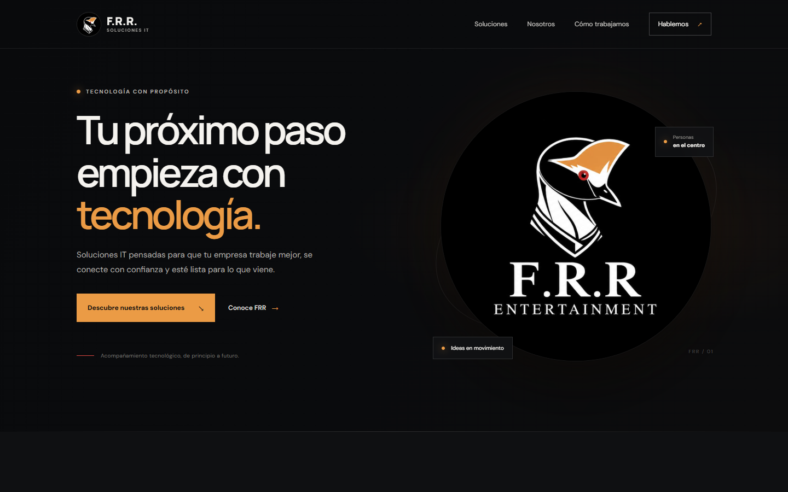

# FRR Soluciones IT

Sitio institucional de **FRR Soluciones IT** (F.R.R. Entertainment): software y soluciones digitales, soporte
tecnológico y acompañamiento para empresas.

[](https://github.com/F-R-R-ENTERTAINMENT/f-r-r-entertainment.github.io/actions/workflows/validar.yml)

**[Ver el sitio](https://f-r-r-entertainment.github.io/)**



## Qué incluye

- **Una sola página** con las secciones Inicio, Quiénes somos, Soluciones, Cómo trabajamos y Contacto.
- **Diseño adaptable** a escritorio y celular, con menú desplegable en pantallas chicas.
- **Encabezado fijo** que toma fondo al desplazarse y resalta la sección que se está viendo.
- **Contacto directo:** botón para escribir un email con el asunto completado y botón para copiar la dirección.
- **Accesibilidad:** enlace para saltar al contenido, foco visible en el teclado, menú que se cierra con Escape
  y animaciones reducidas si el sistema lo pide.
- **Buscadores y redes:** descripción, URL canónica, vista previa al compartir el enlace (Open Graph y Twitter),
  datos estructurados de la organización, `robots.txt`, `sitemap.xml` y una página 404 propia.
- **Sin dependencias:** HTML, CSS y JavaScript, con las fuentes DM Sans y Manrope de Google Fonts.

## Estructura

```text
index.html          # página principal
404.html            # página para direcciones que no existen
css/style.css       # estilos, variables de color y diseño adaptable
js/main.js          # menú, encabezado, sección activa, copiar email y año del pie
assets/             # logos, ícono para iPhone e imagen para compartir el enlace
robots.txt          # indicaciones para buscadores
sitemap.xml         # mapa del sitio
.htmlvalidate.json  # reglas de validación del HTML
.github/            # validación automática del HTML y de los enlaces
```

## Ver los cambios en local

El sitio es estático, así que alcanza con cualquier servidor web. Desde la raíz del repositorio:

```sh
python -m http.server 8000
```

y abrí <http://localhost:8000>. Abrir `index.html` directamente también funciona, aunque la página 404 usa rutas
absolutas y se ve bien solo desde un servidor.

## Validación

GitHub Actions valida el HTML con [html-validate](https://html-validate.org/) y revisa que existan todos los archivos
y anclas a los que apuntan las páginas, en cada cambio y en cada pull request. Para correrlo en local, con Node:

```sh
npx html-validate index.html 404.html
node .github/scripts/check-links.mjs . index.html 404.html
```

## Publicación

El sitio se publica con GitHub Pages desde la rama `main`: cada cambio que llega a `main` queda en línea en
<https://f-r-r-entertainment.github.io/> en uno o dos minutos. El archivo `.nojekyll` hace que Pages sirva los
archivos tal cual, sin procesarlos con Jekyll.

Si cambia la dirección del sitio, hay que actualizar la URL en `index.html` (canónica, Open Graph y datos
estructurados), `robots.txt` y `sitemap.xml`.
